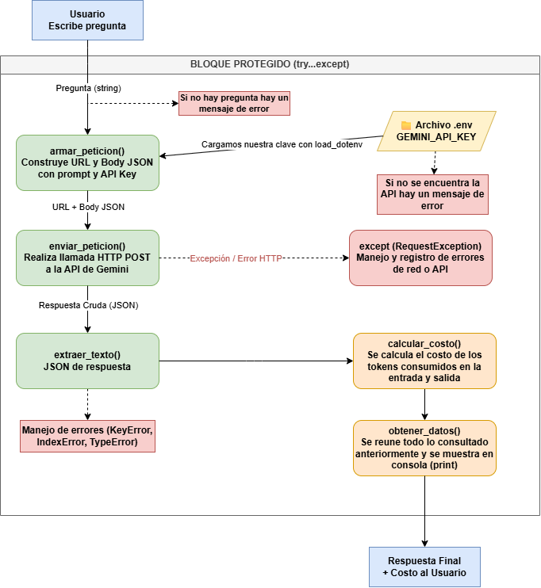

# Decisión de arquitectura: elección de modelo

**Fecha:** 2026-10-23

**Estado:** Vigente por ahora. No es definitiva y puede cambiar a futuro.

## Modelo elegido

**`gemini-3.6-flash`**

## Diagrama de arquitectura




## Comparación de candidatos

Mismo prompt (clima de Santiago, "¿Cómo estará el clima durante el resto del día?"), 4 repeticiones por modelo, timeout de 30 s.

   ```
   Modelo                  Exitosas    Latencia prom.    Costo prom. (USD)
   gemini-3.8-flash        0/4         —                 —
   gemini-3.6-flash        4/4         8.62 s            $0.004003
   gemini-3.1-flash-lite   3/4         4.69 s            $0.000228
   ```

## Justificación

Elijo `gemini-3.6-flash` pensando en la **confiabilidad y la calidad** que necesitará el proyecto a largo plazo. Mi idea es escalar la miniaplicación hacia una página tipo Google Earth con datos del clima, donde se puedan explorar fenómenos como El Niño. Eso exige respuestas más precisas y mejor razonamiento sobre los datos, y en la prueba este modelo fue el único con 4 de 4 respuestas exitosas y el que mejor interpretó "el resto del día".

Acepto que es unas 17 veces más caro y casi el doble de lento que `gemini-3.1-flash-lite`. Con pocos usuarios el costo es manejable, pero si el uso crece habrá que vigilarlo.

## Alternativa descartada y por qué

Descarto `gemini-3.1-flash-lite`: es mucho más barato y rápido, pero falló 1 de 4 pruebas y sus respuestas fueron más genéricas, algo que pesa más a medida que las consultas se vuelvan complejas. `gemini-3.8-flash` quedó fuera porque falló por timeout en todas las pruebas y no se pudo evaluar.

Esta decisión no es definitiva: si el costo se dispara o aparecen modelos nuevos, la revisaré (por ejemplo, usando flash-lite para consultas simples y 3.6-flash para las complejas).